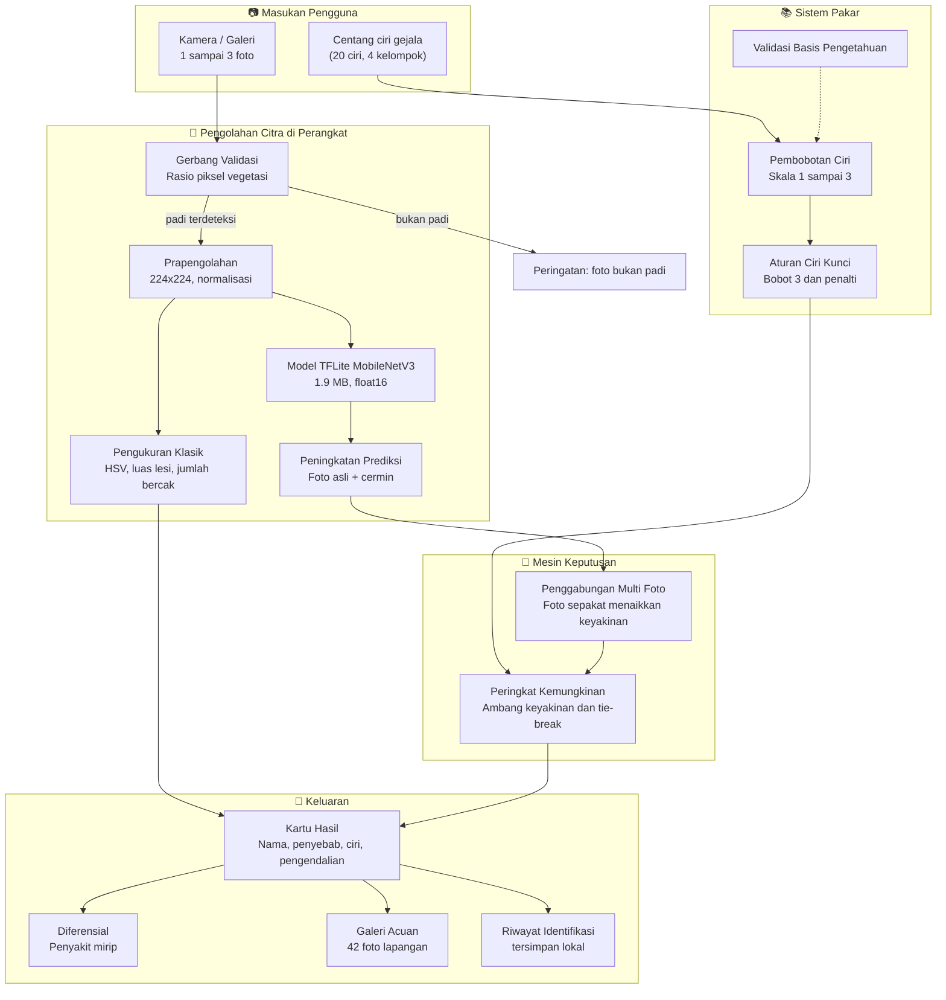

# 🌾 SIDEPI — Sistem Identifikasi Penyakit Padi Berbasis Kecerdasan Buatan

<p align="center">
  <strong>Pendamping Digital Petugas Lapangan Dinas Pertanian dan Pangan Kabupaten Sumba Timur</strong><br>
  <em>Menggabungkan model pengenalan citra di perangkat, sistem pakar berbasis ciri, dan galeri foto acuan dalam satu aplikasi Android yang bekerja tanpa internet.</em>
</p>

<p align="center">
  
  
  
  
  
</p>

<p align="center">
  <a href="https://github.com/arifrenggy/sidepi-app/releases/latest">
    
  </a>
</p>

---

### Uji pemisahan bercak blas dan bercak coklat

Dua percobaan sudah dilakukan untuk memisahkan kedua penyakit ini pada tingkat
potongan bercak, keduanya tidak dipakai di aplikasi karena hasilnya bias.

| Percobaan | Potongan | Blas tepat | Bercak coklat tepat |
| :--- | ---: | ---: | ---: |
| Kotak potong seragam | 15.903 | 98% | 40% |
| Skala bercak diseragamkan, rotasi 8 arah | 18.233 | 96% | 29% |

Model selalu condong menyebut blas. Karena itu aplikasi tidak menebak: bila hasil
teratas dan pesaing terdekat adalah pasangan yang dikenal mirip, aplikasi
menampilkan pertanyaan konfirmasi dan dua foto acuan berdampingan agar petugas
membandingkan sendiri.

## 📖 Tentang SIDEPI

**SIDEPI** (*Sistem Identifikasi Penyakit Padi*) adalah aplikasi Android yang dibuat untuk membantu petugas pengamat organisme pengganggu tumbuhan dan penyuluh pertanian di Kabupaten Sumba Timur dalam mengenali penyakit serta hama tanaman padi secara cepat di lapangan. Aplikasi ini dirancang untuk kondisi nyata di wilayah kerja: banyak lokasi tidak memiliki sinyal internet, dan perangkat yang dipakai adalah ponsel kelas menengah.

Karena itu seluruh proses berjalan **di dalam perangkat**, tanpa server, tanpa pengiriman foto ke luar ponsel. Pengguna dapat memilih salah satu dari dua jalur identifikasi yang saling melengkapi:

1. **Jalur foto**: memotret 1 sampai 3 bagian tanaman, model mengenali gejala secara visual, lalu menampilkan peringkat penyakit beserta tingkat keyakinan.
2. **Jalur ciri**: mencentang gejala yang benar-benar terlihat, sistem pakar menghitung skor kemungkinan berdasarkan bobot ciri dan aturan ciri kunci.

Kedua jalur menghasilkan keluaran yang dapat ditelusuri: nama penyakit, penyebab, ciri pembeda, langkah pengendalian, penyakit lain yang mirip, serta foto acuan lapangan sebagai pembanding visual.

---

## 🏗️ Arsitektur Aliran Data



---

## 🌟 Modul dan Fitur Unggulan

### 1. Pengenalan Tujuh Kelas Penyakit dan Hama

Model klasifikasi citra mengenali **tujuh kondisi** sekaligus, bukan hanya penyakit yang lazim dibahas di buku:

| Kelas | Nama tampil | Jenis |
| :--- | :--- | :--- |
| `blas` | Blas | Penyakit jamur |
| `tungro` | Tungro | Penyakit virus |
| `kresek` | Kresek (hawar daun bakteri) | Penyakit bakteri |
| `bercak_coklat` | Bercak daun coklat | Penyakit jamur |
| `penggerek` | Hama penggerek batang | Hama (sundep dan beluk) |
| `penggulung` | Hama putih palsu (penggulung daun) | Hama |
| `sehat` | Daun sehat | Kontrol |

Dua kelas hama ditambahkan agar aplikasi tidak selalu memaksa memberi label penyakit pada kerusakan yang sebenarnya disebabkan serangga.

### 2. Peningkatan Prediksi dengan Cermin (Test-Time Augmentation)

Setiap foto dianalisis dua kali, yaitu foto asli dan salinan cermin kiri kanannya, lalu kedua keluaran dirata-ratakan. Cara ini menaikkan akurasi total dari 95,8% menjadi **97,1%** dan mengangkat kelas terlemah ke ambang 90%, tanpa menambah ukuran model sama sekali.

### 3. Identifikasi dari Beberapa Foto Sekaligus

Satu foto sering menyesatkan: bercak di satu helai daun bisa berasal dari jamur berbeda. SIDEPI menerima 2 sampai 3 foto, misalnya helai daun, pangkal batang, dan malai. Hasil tiap foto dijumlahkan dengan pembobotan, sehingga foto yang sepakat menghasilkan keyakinan lebih tinggi dan foto yang menyimpang menurunkan keyakinan. Dengan begitu aplikasi berani menyimpulkan "tidak yakin, perlu pemeriksaan lanjutan" ketika bukti visual saling bertentangan, alih-alih memaksakan jawaban.

### 4. Gerbang Validasi Foto Bukan Padi

Sebelum model dijalankan, aplikasi mengukur kepadatan piksel vegetasi berwarna hijau. Foto padi yang wajar berada pada rentang 74% sampai 99%, sedangkan foto bukan tanaman hanya 2% sampai 39%. Foto di luar rentang ditolak dengan pesan yang jelas, sehingga kiriman foto sembarangan tidak menghasilkan diagnosis palsu.

### 5. Sistem Pakar Berbasis Pilihan Ciri

Jalur kedua tidak memakai kamera sama sekali. Petugas memilih kelompok gejala (daun, batang, malai, atau pertumbuhan), lalu mencentang ciri yang terlihat. Mesin penilaian menghitung skor tiap penyakit, menerapkan aturan **ciri kunci** berbobot 3, memberi penalti bila ciri kunci tidak dipilih, dan menyelesaikan skor seri secara deterministik. Hasilnya disertai label keyakinan, bukan sekadar peringkat kosong.

### 6. Galeri Foto Acuan Lapangan

Aplikasi membawa **42 foto acuan**, enam foto untuk setiap kelas, yang diambil dari kelompok foto berbeda agar tidak seragam. Setiap subfolder kelas wajib didaftarkan satu per satu di `pubspec.yaml`, karena Flutter tidak membaca isi subfolder aset secara otomatis; `test/aset_test.dart` menjaga agar kesalahan itu tidak terulang. Galeri dapat dibuka dari hasil pemeriksaan foto, dari hasil analisis ciri, maupun dari menu tersendiri di beranda. Foto dapat diperbesar sampai empat kali untuk melihat bentuk bercak dan pola kerusakan. Total ukurannya hanya 652 KB.

### 7. Penjelasan Lengkap dan Diferensial

Setiap hasil disertai penyebab, empat ciri pembeda, lima langkah pengendalian, dan dua penyakit lain yang gejalanya mirip. Bagian diferensial ini penting karena kesalahan diagnosis di lapangan umumnya terjadi pada pasangan penyakit yang mirip, seperti kresek dengan blas, atau serangan penggerek dengan kresek.

### 8. Riwayat Identifikasi di Perangkat

Hasil yang disimpan petugas tercatat lengkap dengan waktu, ciri yang dipilih, penyakit, dan skornya. Data ini dapat dipakai sebagai bahan rekap kegiatan pengamatan tanpa memerlukan koneksi.

### 9. Bekerja Penuh Tanpa Internet

Model, penjelasan, dan seluruh foto acuan dibundel di dalam APK. Tidak ada permintaan jaringan sama sekali saat aplikasi dipakai.

---

## 📊 Data Latih dan Hasil Pengujian

Dataset berisi **11.006 foto** yang berasal dari **2.936 foto sumber asli**. Selisih besar itu penting dijelaskan: banyak dataset publik sudah diaugmentasi, sehingga satu foto bisa muncul dalam delapan variasi. Bila variasi tersebut dibiarkan, foto yang sama dapat masuk ke data latih dan data uji sekaligus, dan akurasi yang dilaporkan menjadi palsu.

Karena itu seluruh foto dikelompokkan lebih dulu berdasarkan kemiripan fitur (ambang kosinus 0,95), lalu pembagian data dilakukan **per kelompok foto asli**, bukan per berkas. Persentase di bawah ini dihitung pada 2.008 foto uji yang berasal dari 588 kelompok foto yang tidak pernah dilihat model.

| Kelas | Foto | Foto asli | Akurasi |
| :--- | ---: | ---: | ---: |
| Bercak daun coklat | 1.600 | 337 | 95% |
| Blas | 1.760 | 425 | 95% |
| Bukan padi (jagung, tebu, teh, kapas, goni) | 1.460 | 303 | 98% |
| Kresek | 1.585 | 256 | 95% |
| Daun sehat | 1.488 | 94 | 100% |
| Penggerek batang | 1.200 | 206 | 98% |
| Putih palsu (penggulung daun) | 605 | 119 | 97% |
| Tungro | 1.308 | 268 | 100% |
| **Total** | **11.006** | **2.008** | **96,5%** |

Sumber data:

1. **Rice Leaf Disease Dataset** (Kaggle) untuk blas, tungro, kresek, bercak coklat, dan daun sehat.
2. **Rice Disease and Pest Dataset** (Hugging Face: `minhhungg/rice-disease-dataset`) untuk penggerek batang (Chilo 745 foto dan yellow stem borer 455 foto) dan putih palsu (Rice Leaf Folder 605 foto).

Catatan metodologis: angka 97,1% berlaku pada data uji yang mayoritas berupa foto laboratorium dan internet. Akurasi lapangan di Sumba Timur diperkirakan lebih rendah karena perbedaan latar, cahaya, dan stadia serangan. Pengujian lapangan masih menjadi pekerjaan berikutnya.

---

## 🚀 Memasang Aplikasi

### Unduhan langsung

Rilis terbaru tersedia di halaman [Releases](https://github.com/arifrenggy/sidepi-app/releases/latest).

| Berkas | Ukuran | Peruntukan |
| :--- | ---: | :--- |
| `sidepi-arm64.apk` | 24,2 MB | Ponsel Android keluaran 2018 ke atas (disarankan) |
| `sidepi-universal.apk` | 63,1 MB | Ponsel lama atau bila versi ringan gagal dipasang |

Langkah pemasangan:

1. Unduh berkas APK sesuai perangkat.
2. Buka berkas, lalu izinkan pemasangan dari sumber tidak dikenal bila diminta.
3. Pasang, buka aplikasi, dan berikan izin kamera saat diminta.

### Membangun sendiri

```bash
flutter pub get
flutter test
flutter build apk --release --split-per-abi
```

Berkas hasil build berada di `build/app/outputs/flutter-apk/`. Pipeline GitHub Actions pada `.github/workflows` membangun APK otomatis setiap kali kode masuk ke cabang `main`, lalu menerbitkannya sebagai rilis GitHub.

---

## 🧪 Pengujian

```bash
flutter test
```

Cakupan pengujian saat ini:

1. `test/logika_test.dart`: 10 kasus untuk mesin penilaian, mencakup aturan ciri kunci, penalti, skor seri, dan ambang keyakinan.
2. `test/citra_test.dart`: pengujian gerbang validasi foto, ekstraksi ciri warna, dan perhitungan luas lesi.

---

## 🗂️ Struktur Proyek

```text
sidepi-app/
├── lib/
│   ├── main.dart              # Layar beranda, alur ciri, riwayat, panduan
│   ├── periksa_foto.dart      # Alur kamera, hasil foto, penggabungan multi foto
│   ├── galeri_acuan.dart      # Galeri 42 foto acuan dan daftar per kelas
│   ├── model_foto.dart        # Pembungkus TFLite, prapengolahan, TTA cermin
│   ├── citra.dart             # Pengolahan citra klasik: HSV, lesi, gerbang validasi
│   ├── logika.dart            # Mesin penilaian sistem pakar
│   ├── models.dart            # Model basis pengetahuan dan validasinya
│   └── penyimpanan.dart       # Riwayat identifikasi lokal
├── assets/
│   ├── models/sidepi_model.tflite   # Model 1,9 MB, float16
│   ├── acuan/                       # 42 foto acuan, 6 per kelas
│   ├── gejala/                      # Foto utama tiap penyakit
│   ├── detail_penyakit.json         # Penjelasan, ciri, pengendalian, diferensial
│   ├── acuan.json                   # Indeks foto acuan
│   └── basis-pengetahuan.json       # Basis sistem pakar, 3 penyakit, 20 ciri
├── test/                            # Pengujian logika dan citra
└── docs/                            # Prototipe web untuk uji coba cepat
```

---

## 🔄 Mengganti Basis Pengetahuan

Basis sistem pakar berupa berkas teks yang dapat disunting langsung pada `assets/basis-pengetahuan.json`, sehingga penyuluh dapat memperbaiki isi tanpa menyentuh kode program. Aturan yang wajib dipatuhi:

1. Setiap penyakit memakai `id` unik.
2. Bobot ciri berada pada skala 1 sampai 3.
3. Setiap penyakit wajib memiliki minimal satu ciri kunci berbobot 3.
4. Kelompok ciri harus salah satu dari `daun`, `batang`, `malai`, atau `pertumbuhan`.

Aplikasi memvalidasi berkas ini saat dibuka dan menolak menjalankan basis yang tidak lolos aturan, disertai pesan kesalahan yang menyebut nomor aturan yang dilanggar.

Berbeda dari basis pengetahuan, **model citra tidak dapat disunting manual**. Bila data baru dari lapangan sudah terkumpul, model harus dilatih ulang, diekspor ke TFLite, lalu berkas `assets/models/sidepi_model.tflite` diganti.

---

## ⚠️ Batasan yang Perlu Diketahui

1. Model belum diuji dengan foto lapangan Sumba Timur. Seluruh pengujian masih memakai data publik.
2. Kelas blas adalah yang paling rapuh, 90%, dan paling sering tertukar dengan bercak coklat serta kresek.
3. Serangan hama lain di luar penggerek batang dan putih palsu belum dikenali, misalnya wereng batang coklat, thrips, dan ganjur.
4. Basis sistem pakar masih memuat tiga penyakit. Data resmi dari dinas belum diterima, sehingga isinya perlu diverifikasi penyuluh sebelum dipakai untuk keputusan penyemprotan.
5. Aplikasi memberi peringkat kemungkinan, bukan kepastian diagnosis. Keputusan pengendalian tetap berada pada petugas dan penyuluh.

---

## 🗺️ Rencana Pengembangan

1. Pengumpulan dan pelabelan foto lapangan Sumba Timur bersama petugas pengamat, minimal 100 foto per kelas.
2. Pelatihan ulang model dengan data lapangan tersebut, disertai pengujian pada musim tanam berbeda.
3. Penambahan basis pengetahuan untuk hama lain, terutama wereng batang coklat dan ganjur.
4. Eksplorasi deteksi objek untuk menghitung populasi hama, bukan sekadar mengenali jenis kerusakan.
5. Pencatatan lokasi dan waktu pengamatan untuk kebutuhan rekap sebaran serangan di tingkat kabupaten.
6. Publikasi ke Google Play setelah pengujian lapangan selesai.

---

## 🛠️ Tumpukan Teknologi

1. **Bahasa dan kerangka**: Dart 3 dan Flutter (Material 3).
2. **Kecerdasan buatan**: TensorFlow dan Keras untuk pelatihan, TensorFlow Lite (`tflite_flutter`) untuk inferensi di perangkat.
3. **Arsitektur model**: MobileNetV3Small, masukan 224x224, klasifikasi tujuh kelas, kuantisasi float16.
4. **Pengolahan citra**: paket `image` untuk konversi ruang warna, segmentasi ambang, dan pengukuran lesi.
5. **Kamera**: `image_picker`.
6. **Penyimpanan lokal**: `shared_preferences`.
7. **Otomasi build**: GitHub Actions untuk kompilasi dan penerbitan rilis.

---

## 👤 Pengembang

**Kurniawan Arif Renggi**
Mahasiswa Teknik Informatika, Universitas Katolik Widya Mandala Surabaya Kampus Kota Waingapu.
Aplikasi ini dikembangkan dalam rangka kerja praktik di Dinas Pertanian dan Pangan Kabupaten Sumba Timur.

- GitHub: [@arifrenggy](https://github.com/arifrenggy)
- Repositori lain: [GeoSiaga](https://github.com/arifrenggy/GeoSiaga)

---

## 📄 Keterangan Lisensi

Kode dan model dalam repositori ini dikembangkan untuk keperluan dinas dan akademik di lingkungan Dinas Pertanian dan Pangan Kabupaten Sumba Timur. Penggunaan komersial, penerbitan ulang, atau integrasi ke sistem lain sebaiknya dikoordinasikan dengan pengembang dan dinas terlebih dahulu. Berkas lisensi resmi akan ditambahkan bila proyek ini dibuka untuk publik secara luas.

Dataset latih berasal dari sumber publik dengan ketentuan masing-masing penyedia. Data lapangan yang dikumpulkan bersama dinas tetap menjadi milik dinas dan tidak dipublikasikan tanpa izin.
