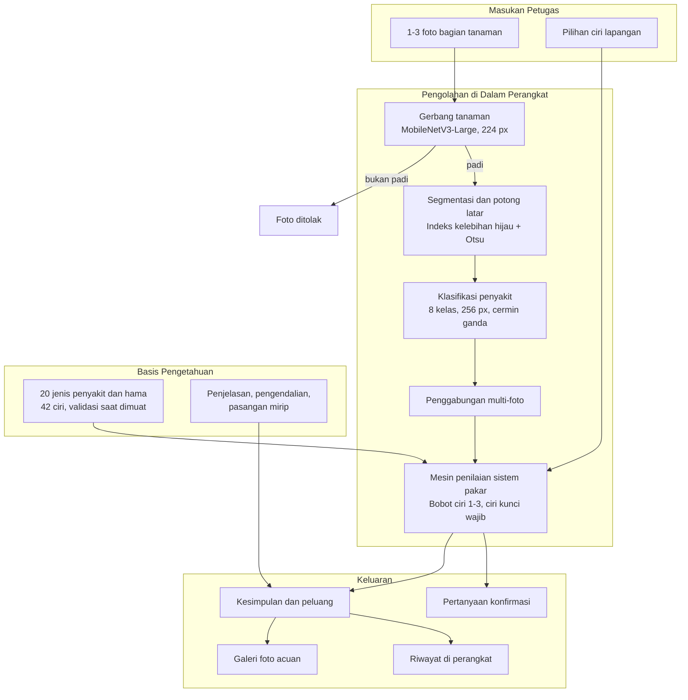

# 🌾 SIDEPI — Sistem Identifikasi Penyakit dan Hama Padi

<p align="center">
  <strong>Aplikasi Identifikasi Penyakit dan Hama Padi untuk Petugas Lapangan</strong><br>
  <em>Model pengenalan citra dua tahap, sistem pakar 42 ciri, dan galeri acuan lapangan dalam satu aplikasi Android yang bekerja penuh tanpa koneksi internet.</em>
</p>

<p align="center">
  <a href="https://github.com/arifrenggy/sidepi-app/releases/latest">
    
  </a>
  
  
  
  
</p>

---

## 📖 Tentang SIDEPI

**SIDEPI** (*Sistem Identifikasi Penyakit Padi*) adalah aplikasi Android untuk membantu petugas pengamat organisme pengganggu tumbuhan (POPT) dan penyuluh pertanian mengenali penyakit serta hama padi di lapangan. Aplikasi dikembangkan untuk kondisi kerja di Kabupaten Sumba Timur, tempat banyak lokasi pengamatan tidak terjangkau sinyal internet dan perangkat yang dipakai adalah ponsel kelas menengah.

Seluruh proses berjalan **di dalam perangkat**. Foto tidak dikirim ke server, tidak ada API berbayar, dan tidak ada ketergantungan jaringan. Aplikasi menyediakan dua jalur identifikasi yang saling melengkapi:

- **Periksa foto** — satu sampai tiga foto bagian tanaman dibaca model pengenalan citra.
- **Identifikasi lewat ciri** — petugas mencentang gejala yang benar-benar terlihat, lalu mesin penilaian mencocokkannya dengan basis pengetahuan.

Kedua jalur merujuk pada basis pengetahuan yang sama, yaitu **20 jenis penyakit dan hama** dengan **42 ciri lapangan**, dan menampilkan foto acuan, penjelasan, kemungkinan lain yang mirip, serta anjuran pengendalian.

---

## 🏗️ Arsitektur Aliran Data (Data Pipeline Flow)



Tahap segmentasi hanya memotong foto yang diambil dari jarak jauh. Foto jarak dekat dibiarkan utuh karena pemotongan menghilangkan bentuk dan tepi daun yang dipakai pada tahap berikutnya. Pengukuran bagian tanaman, rasio bentuk, dan kelurusan tepi tetap ditampilkan sebagai keterangan pendukung.

---

## 🌟 Modul dan Fitur Utama

### 1. Gerbang Validasi Tanaman
Gerbang biner berbasis **MobileNetV3-Large** (masukan 224 × 224) memisahkan foto padi dari foto tanaman lain sebelum analisis. Foto yang dinilai bukan padi tidak diproses menjadi diagnosis, sehingga aplikasi tidak memberi vonis penyakit pada objek yang salah.

### 2. Klasifikasi Delapan Kelas
Model penyakit mengenali **blas, bercak coklat, kresek, penggerek, penggulung, tungro, sehat,** dan **bukan padi** pada masukan 256 × 256. Setiap foto diuji dua kali dengan pencerminan horizontal, lalu peluangnya dirata-rata (*test-time augmentation*) untuk menekan kesalahan acak.

### 3. Segmentasi dan Pemotongan Latar
Citra diubah ke indeks kelebihan hijau (*excess green*), dipisahkan dengan ambang Otsu, lalu komponen terbesar diambil sebagai bagian tanaman. Foto yang diambil dari jauh dipotong ke area tanaman agar bercak terlihat lebih besar, sedangkan foto jarak dekat dibiarkan.

### 4. Penggabungan Banyak Foto
Hingga tiga foto dari bagian tanaman berbeda digabung menjadi satu kesimpulan, dengan pembobotan menurut keyakinan tiap foto. Foto yang ditolak gerbang atau dinilai bukan padi tidak ikut menentukan hasil.

### 5. Sistem Pakar Berbasis Ciri
Mesin penilaian memberi bobot 1 sampai 3 pada setiap ciri. Skor 60 ke atas disertai minimal satu **ciri kunci** (bobot 3) diangkat sebagai hasil utama; di bawah itu ditampilkan sebagai kemungkinan yang perlu diverifikasi. Maksimal tiga kemungkinan ditampilkan dengan urutan skor menurun.

### 6. Klarifikasi Terarah
Blas dan bercak coklat sulit dipisahkan pada tingkat bercak. Karena itu, bila dua kandidat teratas adalah pasangan yang dikenal mirip, aplikasi mengajukan pertanyaan ciri dan menampilkan dua foto acuan berdampingan agar petugas memutuskan berdasarkan pengamatan sendiri, bukan menebak.

### 7. Galeri Acuan Lapangan
**42 foto lapangan** untuk tujuh kondisi, dapat diperbesar dan digeser. Setiap foto disertai penjelasan singkat, dan daftar sumber serta lisensi dapat dibuka langsung dari aplikasi.

### 8. Riwayat dan Panduan Pemakaian
Hasil pemeriksaan tersimpan di perangkat dengan `shared_preferences`, tanpa akun dan tanpa unggahan data. Layar panduan memuat cara pakai, batasan model, dan penafian.

---

## 📊 Dataset dan Sumber Data

| Sumber | Jumlah | Lisensi | Pemakaian |
| :--- | ---: | :--- | :--- |
| `paddy-disease-classification` (Kaggle, cermin Hugging Face `anthony2261`) | 10.407 | CC BY 4.0 | foto lapangan, 10 kelas |
| Rice Leaf Diseases, PlantVillage, Rice Leaf Disease Image (Kaggle) | 9.228 | CC BY 4.0 dan tidak dinyatakan | foto laboratorium, kelas bukan padi |
| Roboflow Universe `utopialab/rice-leaf-wfax3` | 5.188 | CC BY 4.0 | kotak berlabel per bercak |
| Zenodo 15817084 | 1.913 | CC BY 4.0 | bahan uji tetap, tidak dipakai melatih |

Beberapa dataset publik memuat foto yang sama dalam resolusi berbeda, sehingga seluruh bahan diperiksa dengan sidik **dhash 64 bit** dan ambang jarak Hamming 12.

| Perbandingan | Duplikat |
| :--- | ---: |
| Roboflow terhadap data latih | 63,4% |
| DatasetNinja terhadap data latih | 63,8% |
| GitHub `aldrin233/RiceDiseases-DataSet` | 100,0% |
| Zenodo terhadap data latih | 0,0% |

Setelah penyaringan, foto Roboflow yang benar-benar baru berjumlah **313** dan itu yang dipakai. Dataset yang seluruh isinya duplikat tidak digunakan.

Foto acuan di aplikasi berasal dari dataset lapangan di atas dan **Wikimedia Commons** berlisensi bebas. Rincian per berkas, pemilik, dan lisensi tercatat pada `assets/acuan/sumber.txt` dan dapat dibuka dari aplikasi.

---

## 🧠 Model dan Evaluasi

| Komponen | Keterangan |
| :--- | :--- |
| Gerbang tanaman | MobileNetV3-Large, 224 × 224, keluaran biner |
| Model penyakit | 8 kelas, masukan 256 × 256, normalisasi 0–1 |
| Penguatan prediksi | Cermin ganda (*test-time augmentation*) |
| Format | TensorFlow Lite, dijalankan dengan `tflite_flutter` |
| Berkas | `sidepi_gate.tflite` (6,0 MB), `sidepi_model.tflite` (1,9 MB) |

Seluruh pengujian memakai foto yang tidak dipakai saat pelatihan, dipisah per foto sumber.

| Ujian | v0.11.0 | v0.12.0 |
| :--- | ---: | ---: |
| Pembagian internal per foto sumber | 96,3% | 98,9% |
| Zenodo, 192 foto | 91,7% | 95,8% |
| Roboflow, 31 foto baru | 48,4% | 83,9% |
| Foto lapangan berlabel, 240 foto | 12,1% | 16,7% |

Rincian Zenodo v0.12.0: **blas 96,9%**, **bercak coklat 95,3%**, **kresek 82,8%**.

Angka terakhir pada tabel adalah yang paling menentukan dan paling rendah. Seluruh dataset publik berasal dari kolam foto yang serupa, sehingga model belum terbiasa pada latar, bayangan, dan sudut pengambilan khas sawah Sumba. Perbaikan berikutnya memerlukan foto lapangan berlabel dari penyuluh setempat.

Pemisahan blas dan bercak coklat diuji ulang pada tingkat potongan bercak dengan 15.903 dan 18.233 potongan. Kedua percobaan condong ke blas (98% dan 96%) sehingga tidak dirilis.

---

## 📚 Basis Pengetahuan

`assets/basis-pengetahuan.json` memuat **20 jenis** dan **42 ciri**.

| Kelompok | Isi |
| :--- | :--- |
| Penyakit | blas, hawar daun bakteri, tungro, bercak daun coklat, hawar pelepah, busuk pelepah bakteri, bercak sempit daun, hawar daun bergaris bakteri, busuk batang, bakanae, kerdil hampa, kerdil rumput |
| Hama | wereng batang coklat, wereng hijau, penggerek batang, penggulung daun, walang sangit, keong mas, tikus sawah, ganjur |

Setiap jenis memuat nama ilmiah, penyebab, deskripsi, bobot ciri 1–3, pengendalian kultur, hayati, dan kimia, serta pencegahan. Berkas divalidasi setiap aplikasi dimuat: id ciri harus unik, rujukan ciri harus ada, bobot 1–3, dan tiap jenis wajib memiliki minimal satu ciri kunci. Basis yang gagal validasi tidak dipakai.

Basis disusun melalui studi literatur resmi dan **belum divalidasi POPT**. Anjuran pengendalian kimia sengaja dibuat umum karena dosis harus mengikuti label dan arahan penyuluh.

---

## ⚡ Rekayasa Kinerja dan Efisiensi Perangkat

| Aspek | Implementasi | Dampak |
| :--- | :--- | :--- |
| Inferensi di perangkat | Dua model TensorFlow Lite, tanpa server | Hasil keluar tanpa jaringan dan tanpa biaya API |
| Ukuran model | Gerbang 6,0 MB, penyakit 1,9 MB, total 7,9 MB | APK arm64 tetap 33,8 MB termasuk aset dan foto acuan |
| Analisis citra | Segmentasi dan pengukuran pada resolusi kerja 480 px | Hemat memori pada ponsel kelas menengah |
| Penguatan prediksi | Cermin ganda tanpa model tambahan | Ketahanan terhadap orientasi foto tanpa menambah ukuran |
| Penyimpanan hasil | `shared_preferences`, tanpa basis data | Riwayat tetap ringan dan tidak butuh izin tambahan |
| Validasi basis | Diperiksa saat dimuat, bukan saat dipakai | Basis rusak tidak pernah dipakai diam-diam |

---

## 🗂️ Struktur Proyek

```text
lib/
  model_gerbang.dart    gerbang tanaman
  model_foto.dart       model penyakit, penggabungan multi-foto
  botani.dart           segmentasi latar dan pengukuran bentuk daun
  citra.dart            ciri warna, bercak, status foto
  logika.dart           mesin penilaian sistem pakar
  konfirmasi.dart       pertanyaan konfirmasi dan hitung ulang
  periksa_foto.dart     layar periksa foto
  galeri_acuan.dart     galeri foto acuan
  main.dart             beranda, identifikasi lewat ciri, riwayat, panduan
assets/
  basis-pengetahuan.json   basis pengetahuan dan ciri
  detail_penyakit.json     penjelasan, pengendalian, pasangan mirip
  acuan.json               indeks foto acuan
  models/                  dua berkas TensorFlow Lite
  acuan/, gejala/, brand/  foto acuan, gambar gejala, aset merek
test/                     23 uji logika, citra, aset, dan konfirmasi
tools/catatan_rilis.py    penyusun catatan rilis dari CHANGELOG.md
```

---

## 🛠️ Tumpukan Teknologi (Tech Stack)

- **Kerangka aplikasi**: [Flutter](https://flutter.dev/) (Dart 3), satu basis kode untuk Android
- **Inferensi model**: [tflite_flutter](https://pub.dev/packages/tflite_flutter) 0.11, TensorFlow Lite
- **Pengolahan citra**: [image](https://pub.dev/packages/image) 4.2, dijalankan di isolate terpisah
- **Kamera dan galeri**: [image_picker](https://pub.dev/packages/image_picker) 1.1
- **Penyimpanan lokal**: [shared_preferences](https://pub.dev/packages/shared_preferences) 2.3
- **Pelatihan model**: TensorFlow, dengan pengecekan duplikat dhash memakai Python dan Pillow
- **Integrasi berkelanjutan**: GitHub Actions, membangun APK dan menerbitkan rilis otomatis

---

## ⚠️ Batasan

- Hasil merupakan alat bantu identifikasi, bukan diagnosis final. Keputusan pengendalian tetap berada pada penyuluh.
- Ketepatan pada foto lapangan bebas masih rendah sebagaimana tabel evaluasi.
- Model foto hanya mengenali tujuh kondisi. Jenis lain pada basis pengetahuan dapat diakses melalui jalur identifikasi lewat ciri.
- Basis pengetahuan belum divalidasi POPT Sumba Timur.

---

## 📄 Lisensi

Kode aplikasi ditulis untuk Dinas Pertanian dan Pangan Kabupaten Sumba Timur dan belum diterbitkan dengan lisensi terbuka. Data latih dan foto acuan memakai lisensi asalnya: **CC BY 4.0**, **CC BY-SA**, **CC BY**, dan **public domain**, dengan rincian per berkas pada `assets/acuan/sumber.txt`.

Riwayat perubahan tiap versi, termasuk seluruh versi sebelumnya, ada di [CHANGELOG.md](CHANGELOG.md).
